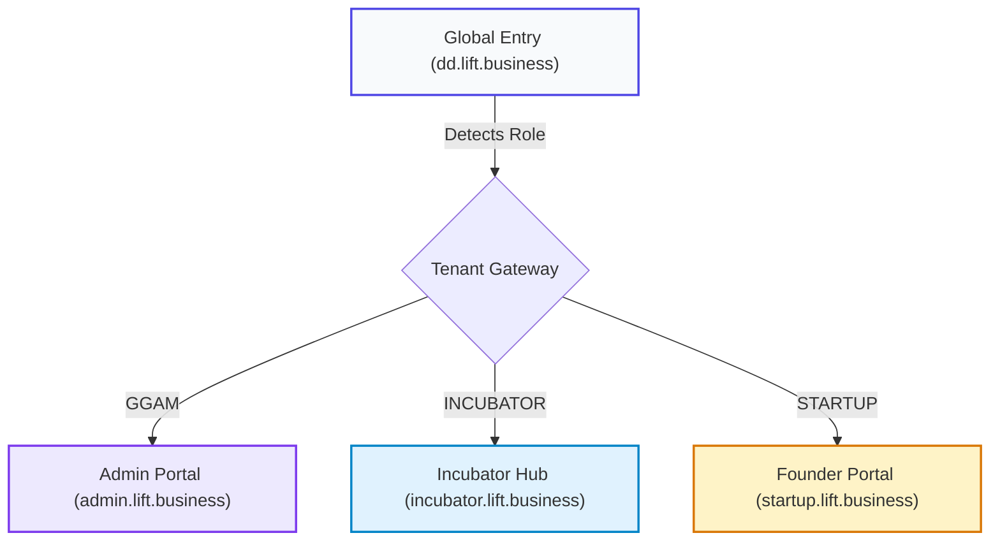

# LIFT Platform Brand Guidelines

> **Institutional Due Diligence & M&A Advisory Platform**  
> *Production Host: [lift.business](https://lift.business)*

---

## 1. Brand Essence & Positioning

### Mission & Core Philosophy
LIFT accelerates institutional due diligence, eliminates opaque communication loops, and provides structured transparency across the venture lifecycle. The platform serves three distinct market participants:
- **GGAM Advisory (Institutional Diligence Officers & Analysts):** In-depth risk evaluation, automated diligence scoring, and transaction oversight.
- **Incubators & Accelerators (Portfolio Managers):** Cohort due diligence tracking, milestone verification, and scheme compliance (TIDE 2.0, SISFS, NIDHI EIR, GENESIS).
- **Startup Founders:** Frictionless Virtual Data Rooms (VDR), self-serve checklist disclosure, and interactive Utilisation Certificate (UC) submissions.

### Brand Tone & Voice
- **Authoritative & Institutional:** Inspires fiduciary confidence through precise financial nomenclature.
- **Clear & Frictionless:** Minimizes cognitive load with clean data tables, transparent status badges, and zero clutter.
- **Modern & Energetic:** Bridges traditional investment banking rigor with cutting-edge, AI-native software aesthetics.

---

## 2. Color System & Design Tokens

### Primary Palette

| Token | Hex / Value | Role & Usage |
| :--- | :--- | :--- |
| `--color-primary` | `#8b5cf6` | Electric Violet &bull; Core brand identity, primary CTA buttons, active state highlights |
| `--color-on-primary` | `#ffffff` | High-contrast white glyphs & text on primary backgrounds |
| `--color-on-primary-container` | `#5b21b6` | Deep Royal Violet &bull; High-emphasis text badges, selected menu items |
| `--color-primary-container` | `rgba(139, 92, 246, 0.15)` | 15% violet wash for subtle button hovers and tag containers |

### Functional & Semantic Accents

| Token | Hex / Value | Semantic Role |
| :--- | :--- | :--- |
| `--color-secondary` | `#3b82f6` | Azure Blue &bull; Incubator hub personality, secondary actions, information alerts |
| `--color-tertiary` | `#f472b6` | Soft Pink / Rose &bull; Micro-interaction badges and subtle graphical accents |
| `--color-success` | `#10b981` | Emerald Green &bull; Accepted documents, verified schemes, active sessions |
| `--color-warning` | `#f59e0b` | Amber Gold &bull; Pending reviews, expiring invites, medium-severity diligence risks |
| `--color-error` | `#ef4444` | Coral Red &bull; Rejected uploads, overdue actions, high-severity diligence alerts |

### Surfaces & Neutrals (Light Theme)

| Token | Hex / Value | Application |
| :--- | :--- | :--- |
| `--color-background` | `#f8fafc` | Staggering canvas background across all dashboard layouts |
| `--color-on-background` | `#0f172a` | Deep Slate &bull; Primary titles, hero headlines |
| `--color-on-surface` | `#1e293b` | Dark Slate &bull; Primary reading text, form labels, table cells |
| `--color-on-surface-variant` | `#64748b` | Medium Slate &bull; Secondary subtitles, descriptions, timestamps |
| `--color-outline` | `rgba(15, 23, 42, 0.2)` | 20% slate &bull; Active input borders, structural boundaries |
| `--color-outline-variant` | `rgba(15, 23, 42, 0.1)` | 10% slate &bull; Subtle dividers, card borders, tab backgrounds |

### Gradients & Ambient Effects
```css
/* Signature Brand Gradient */
--gradient-primary: linear-gradient(135deg, #8b5cf6 0%, #d946ef 100%);

/* Executive Dark Canvas */
--gradient-executive: linear-gradient(135deg, #0f172a 0%, #1e1b4b 100%);

/* Staggering Canvas Backdrop */
--gradient-staggering: linear-gradient(135deg, #f8fafc 0%, #e2e8f0 50%, #f1f5f9 100%);

/* Dual Ambient Glow */
--gradient-ambient: radial-gradient(circle at top right, rgba(139, 92, 246, 0.08), transparent 40%),
                   radial-gradient(circle at bottom left, rgba(59, 130, 246, 0.08), transparent 40%);
```

---

## 3. Glassmorphic Surface System

LIFT utilizes a light glassmorphism visual language to convey depth, cleanliness, and modern software craft:

```
┌────────────────────────────────────────────────────────┐
│ .glass-panel (Top-lit, 20px blur, 7% ambient shadow)   │
│  ┌──────────────────────────────────────────────────┐  │
│  │ .glass-card (10px blur, white reflection top)    │  │
│  │   ┌────────────────────────────────────────────┐ │  │
│  │   │ .glass (Base surface, 12px blur, 1px border│ │  │
│  │   └────────────────────────────────────────────┘ │  │
│  └──────────────────────────────────────────────────┘  │
└────────────────────────────────────────────────────────┘
```

1. **`.glass` (Base Container):**
   - Background: `rgba(255, 255, 255, 0.5)`
   - Backdrop Filter: `blur(12px)`
   - Border: `1px solid rgba(255, 255, 255, 0.6)`
   - Shadow: `0 4px 30px rgba(0, 0, 0, 0.05)`
2. **`.glass-panel` (Sidebars & Navbars):**
   - Background: `linear-gradient(135deg, rgba(255, 255, 255, 0.8) 0%, rgba(255, 255, 255, 0.4) 100%)`
   - Backdrop Filter: `blur(20px)`
   - Border Top: `1px solid #ffffff`
   - Border Edge: `1px solid rgba(255, 255, 255, 0.8)`
   - Shadow: `0 8px 32px rgba(31, 38, 135, 0.07)`
3. **`.glass-card` (Dashboard Widgets & Metric Tiles):**
   - Background: `linear-gradient(180deg, rgba(255, 255, 255, 0.6) 0%, rgba(255, 255, 255, 0.2) 100%)`
   - Backdrop Filter: `blur(10px)`
   - Border Top: `1px solid rgba(255, 255, 255, 0.8)`
   - Border Outline: `1px solid rgba(255, 255, 255, 0.5)`
   - Shadow: `0 4px 15px rgba(0, 0, 0, 0.03)`

---

## 4. Typography Hierarchy

```
Display Large    ──> Outfit 800 (36px / 1.15) • Page Titles & Hero Statements
Headline Medium  ──> Outfit 700 (24px / 1.25) • Section Headers & Modal Titles
Title Medium     ──> Outfit 600 (18px / 1.30) • Card Titles & Table Headers
Body Regular     ──> Outfit / Inter 400 (14px / 1.50) • Descriptions & Form Inputs
Caption / Meta   ──> Outfit 500 (11px / 1.40) • Subtitles & Timestamps
Code / Data      ──> JetBrains Mono 600 (11px) • Hashes, Percentages & Currencies
```

- **Font Family (Display & UI):** **Outfit** (`--font-outfit`)
- **Font Family (Body Fallback):** **Inter** (`--font-inter`)
- **Font Family (Tabular / Monospace):** **JetBrains Mono**
- **Iconography:** **Google Material Symbols Outlined** (variable weight `100..700`, fill `0..1`)

---

## 5. Multi-Tenant Portal Theming Matrix

LIFT enforces dedicated subdomain portals with distinct visual cues and access controls:



### 1. GGAM Advisory (Institutional Admin Portal)
- **Production Host:** `https://admin.lift.business`
- **Internal Route:** `/ggam`
- **Primary Color:** Deep Royal Violet (`#8b5cf6` / `#5b21b6`)
- **Icon:** `admin_panel_settings` / `monitoring`
- **Badge Copy:** `GGAM Advisory`
- **Focus:** Deal pipeline oversight, financial risk triage, advisor scoring, audit trails.

### 2. Incubator Hub (Cohort Management)
- **Production Host:** `https://incubator.lift.business`
- **Internal Route:** `/incubator`
- **Primary Color:** Ocean Azure (`#3b82f6` / `#0284c7`)
- **Icon:** `business` / `monitoring`
- **Badge Copy:** `Incubator Hub`
- **Focus:** Cohort readiness monitoring, government scheme approvals, mentor notes.

### 3. Startup Founder Portal (Virtual Data Room)
- **Production Host:** `https://startup.lift.business`
- **Internal Route:** `/startup`
- **Primary Color:** Electric Violet (`#8b5cf6`) with Amber Risk alerts
- **Icon:** `rocket_launch` / `folder_open`
- **Badge Copy:** `Founder Portal`
- **Focus:** Checklist uploads, interactive Utilisation Certificate, investor disclosures.

---

## 6. Component & Interaction Standards

- **Border Radii:**
  - Base cards & modals: `12px` (`rounded-xl` / `rounded-2xl`)
  - Buttons & input fields: `10px` to `12px`
  - Pill badges & status indicators: `9999px` (`rounded-full`)
- **Micro-Animations:**
  - Enter animation: `animate-fade-in-up` (`0.6s cubic-bezier(0.16, 1, 0.3, 1) forwards`)
  - Staggered children: `animation-delay-100`, `200`, `300`
- **Tactile Button Feedback:**
  - Active press scale: `active:scale-[0.98]`
  - Shadow transitions: `hover:shadow-md transition-all duration-200`
- **Form Fields:**
  - Background: Crisp surface (`#ffffff` or translucent glass)
  - Focused state: `focus:ring-1 focus:ring-primary focus:border-primary`

